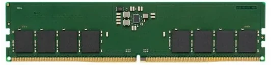
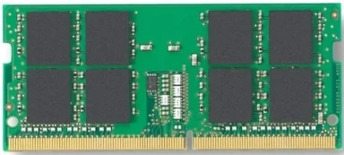
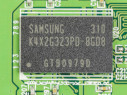
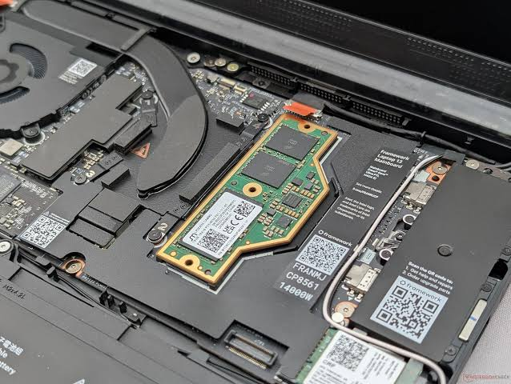

# SA2 – Componentes básicos de un equipo informático: la memoria

**Módulo:** Montaje y Mantenimiento de Equipos (MME) · **Ciclo:** CFGM Sistemas Microinformáticos y Redes (SMR)

> Estos apuntes acompañan a la presentación de clase. Cada apartado amplía una o varias diapositivas. Si algo de la presentación no te queda claro, búscalo aquí por su título. Al final tienes un **glosario**, **preguntas frecuentes** y **actividades**.

**Qué deberías saber hacer al terminar esta SA**

- Explicar para qué sirve cada tipo de memoria de un ordenador y dónde está físicamente.
- Distinguir entre SRAM y DRAM, y entre memoria volátil y no volátil.
- Reconocer a simple vista un módulo DDR3, DDR4 o DDR5, y un DIMM de un SO-DIMM.
- Interpretar la etiqueta de un módulo: generación, velocidad (MT/s), tasa de transferencia, latencia y voltaje.
- Calcular el ancho de banda y la latencia real de una memoria.
- Instalar la memoria en las ranuras correctas para que funcione en *dual channel*.
- Comprobar la compatibilidad entre memoria, procesador y placa base.
- Diagnosticar fallos de memoria con las herramientas adecuadas.

---

## Índice

1. [La memoria en el ordenador: la jerarquía de memoria](#1-la-memoria-en-el-ordenador-la-jerarquía-de-memoria)
2. [Tipos de memoria del sistema](#2-tipos-de-memoria-del-sistema)
3. [Cómo guarda un bit la RAM: SRAM y DRAM](#3-cómo-guarda-un-bit-la-ram-sram-y-dram)
4. [Memoria síncrona y DDR: MHz frente a MT/s](#4-memoria-síncrona-y-ddr-mhz-frente-a-mts)
5. [Generaciones de memoria DDR](#5-generaciones-de-memoria-ddr)
6. [El módulo de memoria por dentro](#6-el-módulo-de-memoria-por-dentro)
7. [Formatos de módulo](#7-formatos-de-módulo)
8. [Parámetros de la memoria](#8-parámetros-de-la-memoria)
9. [Nomenclatura: cómo leer la etiqueta](#9-nomenclatura-cómo-leer-la-etiqueta)
10. [Canales de memoria: *dual channel* y cómo llenar las ranuras](#10-canales-de-memoria-dual-channel-y-cómo-llenar-las-ranuras)
11. [Perfiles XMP y EXPO](#11-perfiles-xmp-y-expo)
12. [Memoria ECC y memoria para servidores](#12-memoria-ecc-y-memoria-para-servidores)
13. [Memoria gráfica (VRAM)](#13-memoria-gráfica-vram)
14. [Memoria virtual](#14-memoria-virtual)
15. [Compatibilidad y elección de la memoria](#15-compatibilidad-y-elección-de-la-memoria)
16. [Instalación paso a paso](#16-instalación-paso-a-paso)
17. [Herramientas de información y diagnóstico](#17-herramientas-de-información-y-diagnóstico)
18. [Síntomas y averías habituales](#18-síntomas-y-averías-habituales)
19. [Tecnologías del pasado y del futuro](#19-tecnologías-del-pasado-y-del-futuro)
20. [Glosario](#20-glosario)
21. [Preguntas frecuentes](#21-preguntas-frecuentes)
22. [Actividades](#22-actividades)
23. [Recursos](#23-recursos)

---

## 1. La memoria en el ordenador: la jerarquía de memoria

El procesador solo puede trabajar con datos que tenga muy cerca. Los programas y documentos están guardados en el disco (SSD o HDD), pero el disco es demasiado lento para que la CPU lea de él cada instrucción. Por eso, entre la CPU y el disco hay varios niveles de memoria, cada uno más rápido, más caro y más pequeño que el anterior. A esta organización se le llama **jerarquía de memoria**.

```
                ▲ más rápida, más cara por GB, menos capacidad
               / \
             /     \
            ─────────
          / Registros \           │ bytes        < 1 ns
         ───────────────
       / Caché L1/L2/L3  \        │ KB – MB      1 – 15 ns
      ─────────────────────
    / Memoria ppal. (RAM)  \      │ GB           60 – 100 ns
    ─────────────────────────
  / Almacenamiento (SSD, HDD) \   │ cientos GB–TB  µs (SSD) – ms (HDD)
 └─────────────────────────────┘
              ▼ más lenta, más barata por GB, más capacidad
```

| Nivel | Dónde está | Volátil | Tamaño típico (2026) | Tiempo de acceso aproximado |
|---|---|---|---|---|
| Registros | Dentro de cada núcleo | Sí | Unos cientos de bytes | Un ciclo de reloj |
| Caché L1 | Dentro de cada núcleo | Sí | 32–80 KB por núcleo | ~1 ns |
| Caché L2 | Dentro de cada núcleo | Sí | 1–3 MB por núcleo | ~3–5 ns |
| Caché L3 | Compartida entre núcleos | Sí | 16–128 MB | ~10–15 ns |
| RAM | Módulos en la placa base | Sí | 8–64 GB | ~60–100 ns |
| SSD NVMe | Ranura M.2 | No | 512 GB–4 TB | ~50–100 µs |
| HDD | Bahía de 3,5" | No | 1–24 TB | ~5–10 ms |

**¿Por qué la caché mejora mucho el rendimiento?** Porque los programas tienen **localidad**:

- **Localidad temporal:** si un dato se acaba de usar, es probable que se vuelva a usar pronto (por ejemplo, la variable de un bucle).
- **Localidad espacial:** si se usa un dato, es probable que se usen los que están al lado (por ejemplo, los elementos de una lista).

Cada nivel guarda una copia de lo que más se está usando del nivel inferior. Así, la mayoría de las veces la CPU encuentra lo que necesita en la caché y casi nunca tiene que esperar al disco.

**Cómo llega un programa a ejecutarse**

1. El programa está guardado en el SSD.
2. Al abrirlo, el sistema operativo copia a la RAM las partes que necesita.
3. La CPU lee las instrucciones y los datos desde la RAM; las que más usa se quedan en la caché.
4. Al cerrar el programa, su espacio en la RAM queda libre. Lo que no se haya guardado en el disco se pierde, porque la RAM es volátil.

> **Idea clave:** la RAM no es "más almacenamiento". Es la mesa de trabajo de la CPU. Cuanto más grande es la mesa, más cosas puedes tener abiertas a la vez sin tener que ir a buscarlas al armario (el disco).

---

## 2. Tipos de memoria del sistema

| Memoria | Función | Volátil | Tecnología | Dónde está |
|---|---|---|---|---|
| **Firmware (BIOS/UEFI)** | Guarda el programa de arranque | No | Flash (EEPROM) | Chip en la placa base |
| **Configuración (la "CMOS")** | Guarda los ajustes de la BIOS y el reloj | Sí, mantenida por la pila | SRAM de bajo consumo / NVRAM | Integrada en el chipset |
| **Caché** | Acelera el acceso a la RAM | Sí | SRAM | Dentro del procesador |
| **RAM (memoria principal)** | Programas y datos en uso | Sí | DRAM (DDR) | Módulos en la placa base |
| **VRAM (memoria de vídeo)** | Texturas e imágenes de la GPU | Sí | GDDR o HBM | En la tarjeta gráfica |

### 2.1 La memoria del firmware (BIOS/UEFI)

Al encender el ordenador, la CPU no tiene nada en la RAM. Necesita un programa guardado en una memoria **no volátil**: el **firmware**, que hoy es UEFI (aunque se le sigue llamando "BIOS" por costumbre).

- Está grabado en un pequeño **chip de memoria flash** de la placa base (normalmente de 16 o 32 MB, conectado por el bus SPI).
- Su nombre técnico viene de la familia **ROM** (*Read Only Memory*), pero hoy **sí se puede reescribir**: por eso se puede **actualizar la BIOS**.
- El firmware hace el **POST** (*Power-On Self-Test*): comprueba la CPU, la RAM y la gráfica, **entrena la memoria** (apartado 18), busca un disco arrancable y cede el control al sistema operativo.

### 2.2 La "CMOS" y la pila

Se sigue llamando **CMOS** a la memoria donde se guardan los **ajustes de la BIOS** (orden de arranque, perfil de la memoria, fecha y hora…). El nombre viene del tipo de chip que se usaba en los años 80.

- Hoy no es un chip aparte: es una pequeña memoria integrada en el **chipset**, junto al **reloj de tiempo real (RTC)**.
- Es volátil, por eso necesita una **pila de botón (CR2032)** para no perder la hora y los ajustes con el equipo desenchufado.
- En muchas placas actuales, parte de la configuración se guarda también en la flash de la UEFI, por lo que algunos ajustes sobreviven aunque se quite la pila.

> **Práctica habitual:** "**borrar la CMOS**" (*Clear CMOS*) devuelve la BIOS a su configuración de fábrica. Se hace con un puente (*jumper*) o botón de la placa, o quitando la pila unos minutos con el equipo desenchufado. Es el primer remedio cuando un perfil de memoria o un *overclock* impide arrancar.
>
> **Síntoma de pila agotada:** el equipo pierde la fecha y la hora cada vez que se desenchufa, o muestra un aviso de "CMOS checksum error" al arrancar.

### 2.3 La memoria caché

La caché está **dentro del procesador**. Está hecha de **SRAM**, mucho más rápida que la RAM, y guarda copias de los datos de la RAM que la CPU está usando. Tiene tres niveles (L1, L2 y L3). Lo viste en detalle en los apuntes del procesador.

### 2.4 La memoria principal (RAM)

Es la memoria que se compra en módulos y se instala en las ranuras de la placa base. Sus características básicas:

- **Acceso aleatorio** (*Random Access Memory*): se tarda lo mismo en leer cualquier posición, a diferencia de una cinta, donde hay que avanzar hasta el dato.
- **Lectura y escritura** rápidas.
- **Volátil:** pierde su contenido al quitar la corriente.
- Su capacidad se mide en **gigabytes (GB)**.

### 2.5 La memoria de vídeo (VRAM)

La tarjeta gráfica dedicada tiene su propia memoria, soldada junto a la GPU. Se explica en el apartado 13.

---

## 3. Cómo guarda un bit la RAM: SRAM y DRAM

Toda la memoria RAM guarda los datos en **celdas**, y cada celda guarda un bit (0 o 1). Hay dos formas de construir esa celda.

### 3.1 SRAM (RAM estática)

- Cada celda es un **biestable** (*flip-flop*) formado por **seis transistores** que se "sujetan" entre sí en estado 0 o 1.
- Mientras tenga alimentación, **mantiene el dato sin necesidad de refresco**. Por eso se llama estática.
- Es **muy rápida**, pero ocupa mucho espacio por bit y es **cara**.
- **Uso:** memoria caché y registros del procesador, y cachés de discos SSD y otros controladores.

### 3.2 DRAM (RAM dinámica)

- Cada celda es **un transistor y un condensador** (celda 1T1C, inventada por Robert Dennard en IBM y patentada en 1968). El condensador cargado es un 1; descargado, un 0.
- Los condensadores son diminutos y **se descargan solos** en milisegundos. Por eso hay que leerlos y volver a cargarlos periódicamente: es el **refresco**. Por eso se llama dinámica.
- Al ocupar muy poco por bit, es **barata y de gran capacidad**.
- **Uso:** memoria principal (DDR), memoria gráfica (GDDR, HBM) y memoria de móviles (LPDDR).
- El primer chip DRAM comercial fue el **Intel 1103 (1970)**.

| | SRAM | DRAM |
|---|---|---|
| Componentes por bit | 6 transistores | 1 transistor + 1 condensador |
| Refresco | No necesita | Sí, cada pocos milisegundos |
| Velocidad | Muy alta | Menor |
| Densidad (bits por mm²) | Baja | Muy alta |
| Coste por GB | Muy alto | Bajo |
| Uso típico | Caché de la CPU | RAM, VRAM |

> **Para entender la diferencia:** la SRAM es como un interruptor de la luz: se queda como lo dejas. La DRAM es como un vaso de agua con un agujerito: si no lo rellenas de vez en cuando, se vacía y pierdes el dato.

---

## 4. Memoria síncrona y DDR: MHz frente a MT/s

### 4.1 De la DRAM asíncrona a la SDRAM

Las primeras DRAM eran **asíncronas**: respondían cuando podían, sin coordinarse con el resto del sistema. En 1993 se estandarizó la **SDRAM** (*Synchronous DRAM*), que trabaja **sincronizada con una señal de reloj** que le envía el controlador de memoria (que antes estaba en el _Northbridge_ y ahora en el propio procesador). Al saber exactamente cuándo llega cada dato, puede trabajar en **ráfagas** (*bursts*) y encadenar operaciones, lo que la hace mucho más rápida.

Toda la memoria actual (DDR, LPDDR, GDDR) es **SDRAM**.

### 4.2 DDR: dos transferencias por ciclo

La SDRAM original (llamada SDR, *Single Data Rate*) transfería un dato por cada ciclo de reloj, en el **flanco de subida** de la señal. La **DDR** (*Double Data Rate*) transfiere un dato en el **flanco de subida** y otro en el **flanco de bajada**: **dos transferencias por ciclo**, con el mismo reloj.

```
Reloj   ┌──┐  ┌──┐  ┌──┐  ┌──┐
        ┘  └──┘  └──┘  └──┘  └──
SDR     ↑     ↑     ↑     ↑          → 4 transferencias
DDR     ↑  ↓  ↑  ↓  ↑  ↓  ↑  ↓       → 8 transferencias
```

### 4.3 MHz y MT/s: por qué hay "dos velocidades"

Aquí está la confusión más habitual:

- **MHz (megahercios):** frecuencia **real** del reloj, en millones de ciclos por segundo.
- **MT/s (megatransferencias por segundo):** millones de **transferencias** de datos por segundo. Es la cifra que se anuncia.

Como la DDR hace dos transferencias por ciclo:

> **Velocidad (MT/s) = Frecuencia de reloj (MHz) × 2**

| Módulo anunciado como | Velocidad real de datos | Reloj del bus |
|---|---|---|
| DDR4-3200 | 3200 MT/s | 1600 MHz |
| DDR5-6000 | 6000 MT/s | 3000 MHz |
| DDR5-6400 | 6400 MT/s | 3200 MHz |

Los fabricantes y las tiendas suelen escribir "DDR5 6000 MHz", pero lo correcto es **6000 MT/s**. Herramientas como CPU-Z o el Administrador de tareas pueden mostrar 3000 MHz para esa misma memoria, y **no es un error**: muestran el reloj real.

Ten en cuenta que una _transferencia_ no es una lectura o una escritura. Una operación de lectura o escritura completa ocupa varias transferencias y varios ciclos de espera.

### 4.4 Entonces, ¿cómo es que DDR2, DDR3, DDR4 y DDR5 son cada vez más rápidas?

Todas son "doble tasa" (dos transferencias por ciclo en el bus). La mejora viene de la técnica de **precarga** (*prefetch*):

- Los chips de DRAM por dentro trabajan **lentos** (unos 200–400 MHz, y casi no han mejorado en 25 años).
- Pero los DDR en cada acceso interno leen **varios bits a la vez** y los envían seguidos por el bus, que es mucho más rápido.
- La mejora está en que cada generación lee más bits por acceso (2, 4, 8, 16) y sube la frecuencia del bus.

| Generación | Precarga (*prefetch*) |
|---|---|
| DDR | 2n |
| DDR2 | 4n |
| DDR3 | 8n |
| DDR4 | 8n + grupos de bancos |
| DDR5 | 16n |

---

## 5. Generaciones de memoria DDR

Cada generación usa **voltajes, señales y contactos distintos**, por lo que **no son compatibles entre sí**: un módulo DDR4 no entra en una ranura DDR5, y viceversa. La posición de la **muesca** lo impide físicamente.

### 5.1 Tabla comparativa (módulos de sobremesa)

| Generación | Año aprox. | Contactos DIMM | Muescas | Voltaje | Velocidades estándar | Capacidad típica por módulo |
|---|---|---|---|---|---|---|
| SDR SDRAM | 1993 | 168 | 2 | 3,3 V | 66–133 MHz | 32–512 MB |
| DDR | 2000 | 184 | 1 | 2,5 V | 200–400 MT/s | 128 MB–1 GB |
| DDR2 | 2004 | 240 | 1 | 1,8 V | 400–1066 MT/s | 512 MB–4 GB |
| DDR3 | 2007 | 240 | 1 | 1,5 V (DDR3L: 1,35 V) | 800–2133 MT/s | 1–8 GB |
| DDR4 | 2014 | 288 | 1 | 1,2 V | 1600–3200 MT/s | 4–32 GB |
| DDR5 | 2021 | 288 | 1 | 1,1 V | 4800–8800 MT/s | 8–64 GB |

**Notas:**

- Las velocidades de la tabla son las **oficiales del estándar** pero hay módulos que permiten _overclocking_ (XMP en Intel / EXPO en AMD): DDR4 hasta ~5000 MT/s y DDR5 por encima de 8000 MT/s.
- **DDR2 y DDR3** tienen los mismos 240 contactos, pero la **muesca está en otra posición**.
- **DDR4 y DDR5** tienen los mismos 288 contactos, pero también tienen **la muesca en distinta posición**.
- Los **años** son de llegada al mercado de consumo; los estándares se publicaron algo antes (DDR5, julio de 2020).
- En DDR5 existen capacidades "no binarias" como **24 GB y 48 GB** por módulo.

### 5.2 Cómo distinguirlas a simple vista

1. **Lee la etiqueta:** pone la generación (DDR4, DDR5 o PC4, PC5). Si no la tiene:
2. **Mira la muesca:** su posición respecto al centro es distinta en cada generación.
3. **Cuenta (o estima) los contactos:** 184, 240 o 288.
4. **Mira el borde inferior:** DDR4 y DDR5 tienen el borde de contactos **ligeramente curvado** (más alto en el centro), para que se inserte con menos fuerza.
5. **Busca un chip pequeño cerca de la muesca:** si tiene un **PMIC** (chip de alimentación) en el propio módulo, es DDR5.

### 5.3 Qué aportó DDR5

- **Más velocidad:** empieza donde acabó DDR4 (4800 MT/s) y llega a 8800 MT/s en el estándar.
- **Dos subcanales de 32 bits por módulo** en lugar de un canal de 64 bits. El módulo sigue teniendo 64 bits de datos, pero puede atender dos peticiones independientes a la vez, lo que mejora la eficiencia.
- **PMIC en el módulo:** la regulación de voltaje pasa de la placa base al propio módulo. Mejor control de la alimentación, aunque el módulo se calienta algo más.
- **ECC interno en el chip** (*on-die ECC*): corrige errores dentro de cada chip. **No es lo mismo que la memoria ECC** (apartado 12).
- **Mayor densidad:** chips de 16, 24 y 32 Gb, que permiten módulos de 32, 48 y 64 GB.

---

## 6. El módulo de memoria por dentro

Un módulo de memoria es una pequeña **placa de circuito impreso (PCB)** con varios chips de DRAM soldados y una fila de contactos dorados para conectarse a la placa base.

```
┌──────────────────────────────────────────────────────────┐
│                         [PMIC]                           │  ← solo DDR5
│ [chip][chip][chip][chip] [SPD] [chip][chip][chip][chip]  │  ← chips DRAM
│▐▐▐▐▐▐▐▐▐▐▐▐▐▐▐▐▐▐▐▐▐▐▐▐▐  ▐▐▐▐▐▐▐▐▐▐▐▐▐▐▐▐▐▐▐▐▐▐▐▐▐▐▐▐▐▐▐│  ← contactos
└──────────────────────────┘└──────────────────────────────┘
                           ↑ muesca
```



| Elemento | Función |
|---|---|
| **PCB** | Placa de varias capas con las pistas que conectan los chips con los contactos. |
| **Chips DRAM** | Guardan los datos. Por dentro se organizan en **bancos**, filas y columnas de celdas. |
| **Contactos (pines)** | Conectan el módulo a la ranura. Son dorados para evitar la oxidación. |
| **Muesca** | Impide insertar el módulo en una ranura de otra generación o al revés. |
| **Chip SPD** | Pequeña memoria EEPROM con la "ficha técnica" del módulo (ver abajo). |
| **PMIC** (DDR5) | Regula los voltajes que necesitan los chips. |
| **CKD** (solo en CUDIMM) | Regenera la señal de reloj para alcanzar velocidades muy altas (apartado 7). |
| **Disipador** | Chapa metálica opcional que ayuda a disipar el calor. Muy habitual en DDR5. |

### 6.1 El chip SPD

El **SPD** (*Serial Presence Detect*) es un pequeño chip que la BIOS lee al arrancar para saber cómo configurar la memoria. Guarda:

- Fabricante, número de pieza y número de serie.
- Tipo de memoria y capacidad.
- Organización (número de chips, *ranks*, ancho de datos).
- Velocidades y temporizaciones oficiales.
- **Perfiles de *overclock*** XMP (Intel) o EXPO (AMD), si el módulo los tiene.
- En DDR5, además, un **sensor de temperatura**.

Gracias al SPD la memoria es *plug and play*: la BIOS la reconoce y la configura sola, sin que tengas que introducir nada a mano.

### 6.2 Ranks (rangos)

Un **rank** es un conjunto de chips que juntos suman los 64 bits de ancho del canal (o 2 × 32 bits en DDR5). El controlador de memoria accede a un rank cada vez.

- **Single rank (1R):** un solo grupo de chips, normalmente todos en una cara.
- **Dual rank (2R):** dos grupos; normalmente hay chips en las dos caras.

Los módulos *dual rank* suelen tener un poco más de rendimiento, pero cargan más el controlador y pueden obligar a bajar la velocidad cuando se instalan cuatro módulos. El rank aparece en la etiqueta (por ejemplo, **1Rx8** o **2Rx8**).

---

## 7. Formatos de módulo

### 7.1 Para ordenadores de sobremesa: DIMM

**DIMM** (*Dual Inline Memory Module*) es el formato de sobremesa desde finales de los 90. Mide unos **133 mm** de largo. Se llama *dual inline* porque los contactos de cada cara son independientes. Su predecesor, el **SIMM** (*Single Inline*), se usó hasta finales de los 90.


### 7.2 Para portátiles y mini PC: SO-DIMM

**SO-DIMM** (*Small Outline DIMM*) es la versión compacta, de unos **67–70 mm**. Se usa en portátiles, mini PC, algunas placas ITX y equipos NAS. Tiene la **misma capacidad y tecnología** que un DIMM de su generación, solo que en otro tamaño.

| Generación | Contactos DIMM | Contactos SO-DIMM |
|---|---|---|
| DDR | 184 | 200 |
| DDR2 | 240 | 200 |
| DDR3 | 240 | 204 |
| DDR4 | 288 | 260 |
| DDR5 | 288 | 262 |




### 7.3 Memoria soldada: LPDDR

En la mayoría de portátiles finos, tabletas y móviles la memoria **no va en módulos**: los chips están **soldados a la placa base**. Es memoria **LPDDR** (*Low Power DDR*), una variante de bajo consumo y muy alta velocidad (LPDDR5X supera los 8000 MT/s).

- **Ventajas:** consume menos, ocupa menos y es más rápida.
- **Inconveniente:** **no se puede ampliar ni sustituir**. Si se avería, hay que cambiar la placa base entera. Antes de comprar un portátil hay que comprobar si la memoria está soldada.


© Raimond Spekking / CC BY-SA 4.0 (via Wikimedia Commons)

### 7.4 El formato nuevo: CAMM2 y LPCAMM2

**CAMM2** (*Compression Attached Memory Module*) es un estándar que sustituye al SO-DIMM en algunos portátiles. En lugar de insertarse en una ranura, el módulo es plano, se apoya sobre un conector de presión y se fija con tornillos.

- **LPCAMM2:** lleva memoria LPDDR5X. Permite tener la velocidad y el bajo consumo de la memoria soldada, pero **siendo sustituible**. Se usa en portátiles profesionales desde 2024.
- **CAMM2 con DDR5:** existe también para sobremesa, pero de momento solo en placas base de demostración y modelos muy concretos.



### 7.5 Variantes de DIMM según su electrónica

| Tipo | Significado | Dónde se usa |
|---|---|---|
| **UDIMM** | *Unbuffered DIMM*: módulo normal | PC de sobremesa |
| **CUDIMM / CSODIMM** | *Clocked UDIMM*: incluye un chip **CKD** que regenera la señal de reloj | PC con DDR5 muy rápida (desde 6400 MT/s) |
| **RDIMM** | *Registered DIMM*: un chip "registro" hace de intermediario entre el controlador y los chips | Servidores y estaciones de trabajo |
| **LRDIMM / MRDIMM** | Variantes de servidor para capacidades o velocidades muy altas | Servidores |

> **Importante:** una placa base de PC **no admite RDIMM**, y una placa de servidor que pide RDIMM no admite UDIMM, aunque los dos sean DDR5 y tengan 288 contactos. Las placas Intel de las series 800 y siguientes admiten CUDIMM; en placas que no los admiten, los CUDIMM funcionan con el CKD desactivado, perdiendo su ventaja.

---

## 8. Parámetros de la memoria

### 8.1 Capacidad

Cantidad de datos que puede guardar. Se mide en **GB**. Más capacidad permite tener más programas y pestañas abiertos sin que el sistema tenga que recurrir al disco (memoria virtual, apartado 14).

> Ojo: **más capacidad no hace el ordenador más rápido** si ya tienes suficiente. Pasar de 8 a 16 GB se nota mucho; pasar de 32 a 64 GB, en un uso normal, no se nota nada.

### 8.2 Velocidad (MT/s)

Número de transferencias por segundo (apartado 4.3). A más velocidad, más ancho de banda.

### 8.3 Ancho de banda (tasa de transferencia)

Cantidad máxima de datos que se pueden mover por segundo entre la memoria y la CPU. Cada canal de memoria tiene un **ancho de 64 bits = 8 bytes** (en DDR5, dos subcanales de 32 bits, que suman lo mismo).

> **Ancho de banda (MB/s) = Velocidad (MT/s) × 8 bytes × número de canales**

**Ejemplos:**

- Un módulo DDR4-3200: 3200 × 8 = **25 600 MB/s** (≈ 25,6 GB/s).
- Ese mismo módulo en _dual channel_: 3200 × 8 x 2 = **51 200 MB/s** (≈ 51,2 GB/s).
- Dos módulos DDR5-6000 en *dual channel*: 6000 × 8 × 2 = **96 000 MB/s** (96 GB/s).

### 8.4 Latencias (temporizaciones)

La latencia es **el tiempo que se tarda desde que se pide un dato hasta que empieza a llegar**. En la etiqueta aparece como una serie de números, por ejemplo **CL30-36-36-76**. Se miden en **ciclos de reloj**:

| Temporización | Nombre | Qué mide |
|---|---|---|
| **CL** (tCL) | *CAS Latency* | Ciclos desde que se pide una columna hasta que sale el dato. Es la más conocida. |
| **tRCD** | *RAS to CAS Delay* | Ciclos para abrir una fila antes de poder leer una columna. |
| **tRP** | *Row Precharge* | Ciclos para cerrar una fila antes de abrir otra. |
| **tRAS** | *Row Active Time* | Tiempo mínimo que una fila debe estar abierta. |

**A menor número, menor latencia**, a igualdad de velocidad.

### 8.5 La latencia real en nanosegundos

Comparar el CL de dos memorias de **distinta velocidad** no tiene sentido, porque los ciclos duran diferente. Para compararlas hay que pasar a nanosegundos:

> **Latencia real (ns) = CL × 2000 / Velocidad (MT/s)**

| Memoria | CL | Latencia real |
|---|---|---|
| DDR4-2400 | 17 | 17 × 2000 / 2400 = **14,2 ns** |
| DDR4-3200 | 16 | 16 × 2000 / 3200 = **10,0 ns** |
| DDR5-4800 | 40 | 40 × 2000 / 4800 = **16,7 ns** |
| DDR5-6000 | 30 | 30 × 2000 / 6000 = **10,0 ns** |
| DDR5-8000 | 40 | 40 × 2000 / 8000 = **10,0 ns** |

**Conclusión:** la latencia real apenas ha cambiado en 20 años (unos 10–15 ns). Lo que ha crecido muchísimo es el **ancho de banda**. Una DDR5 con CL40 no es "más lenta" que una DDR4 con CL16: tarda lo mismo en empezar y luego transfiere mucho más rápido.

### 8.6 Voltaje

Tensión de trabajo de los chips. Ha bajado con cada generación (de 3,3 V a 1,1 V), lo que reduce el consumo y el calor. Los perfiles XMP/EXPO suben el voltaje (por ejemplo, DDR5 a 1,35 V) para alcanzar velocidades mayores.

---

## 9. Nomenclatura: cómo leer la etiqueta

Hay dos formas de nombrar la velocidad de un módulo, y en las etiquetas suelen aparecer las dos.

### 9.1 Por velocidad: DDRx-yyyy

- **x** = generación (2, 3, 4, 5).
- **yyyy** = velocidad en **MT/s**.

Ejemplo: **DDR5-6000** → DDR5 a 6000 MT/s.

### 9.2 Por tasa de transferencia: PCx-zzzzz

- **x** = generación (en DDR1 no se pone número: PC-3200).
- **zzzzz** = tasa de transferencia máxima de un módulo, en **MB/s**.

> **zzzzz = yyyy × 8** (porque el módulo transfiere 8 bytes en cada transferencia)

### 9.3 Tabla de equivalencias

| Nombre por velocidad | Nombre por tasa | Reloj real |
|---|---|---|
| DDR-400 | PC-3200 | 200 MHz |
| DDR2-800 | PC2-6400 | 400 MHz |
| DDR3-1600 | PC3-12800 | 800 MHz |
| DDR3-2133 | PC3-17000 | 1066 MHz |
| DDR4-2666 | PC4-21300 | 1333 MHz |
| DDR4-3200 | PC4-25600 | 1600 MHz |
| DDR5-4800 | PC5-38400 | 2400 MHz |
| DDR5-5600 | PC5-44800 | 2800 MHz |
| DDR5-6000 | PC5-48000 | 3000 MHz |
| DDR5-6400 | PC5-51200 | 3200 MHz |

Los fabricantes redondean (por ejemplo, DDR3-2133 da 17 064, que se etiqueta PC3-17000).

### 9.4 Ejemplo de etiqueta completa

`32GB 2Rx8 PC5-6000B-UD0-1010-XT · DDR5 6000 CL30-36-36-76 1.35V`

| Parte | Significado |
|---|---|
| 32GB | Capacidad del módulo |
| 2Rx8 | Dual rank, chips de 8 bits de ancho |
| PC5-6000B | DDR5, 6000 MT/s (algunos fabricantes ponen la velocidad en lugar de la tasa) |
| UD | UDIMM (módulo normal de sobremesa) |
| CL30-36-36-76 | Latencias CL-tRCD-tRP-tRAS del perfil XMP/EXPO |
| 1.35V | Voltaje del perfil XMP/EXPO |

> En los kits de "gaming" la etiqueta indica las cifras del **perfil XMP/EXPO**, no las del estándar. Si no activas el perfil de _overclocking_ en la BIOS, el módulo funcionará más lento (normalmente a 4800 o 5600 MT/s).

---

## 10. Canales de memoria: *dual channel* y cómo llenar las ranuras

### 10.1 Qué es un canal

Un **canal** es una conexión independiente de **64 bits** entre el **controlador de memoria** y las ranuras. Si hay dos canales, la CPU puede leer de dos módulos a la vez y el ancho de banda se **duplica**.

| Plataforma | Canales | Ejemplos |
|---|---|---|
| PC de sobremesa y portátil | **2 (dual channel)** | Intel Core / Core Ultra, AMD Ryzen |
| Estación de trabajo | 4 u 8 | AMD Threadripper, Intel Xeon W |
| Servidor | 8 o 12 por procesador | AMD EPYC, Intel Xeon 6 |

### 10.2 Cuántas ranuras y cómo se reparten

Las placas de sobremesa tienen normalmente **2 o 4 ranuras**. Con 4 ranuras, cada canal tiene 2 ranuras:

```
CPU ──┬── Canal A: [A1] [A2]
      └── Canal B: [B1] [B2]
```

**Con dos módulos**, hay que ponerlos **uno en cada canal**. En la gran mayoría de placas actuales las ranuras recomendadas son **A2 y B2**, que suelen ser la **2.ª y la 4.ª contando desde el procesador**. La placa suele indicarlo serigrafiado ("DDR5_A2", "DDR5_B2") o en el manual.

> **Siempre consulta el manual de la placa.** La regla "ranuras 1-3 y 2-4" de la presentación anterior no sirve para todas las placas: depende del fabricante y del modelo.

**Errores típicos:**

- Poner los dos módulos juntos, en el mismo canal (A1 y A2): el equipo funciona, pero en *single channel*, con la mitad del ancho de banda.
- Comprar un único módulo de 16 GB en lugar de dos de 8 GB: también se queda en *single channel*.

### 10.3 Requisitos para el *dual channel*

- Un módulo **en cada canal**.
- Lo ideal: **módulos idénticos**, comprados en el **mismo kit**. Así está garantizado que funcionan juntos.
- Si se mezclan módulos distintos, el sistema los hará funcionar a la **velocidad y latencias del más lento**, y puede haber inestabilidad.
- Si los dos canales tienen capacidades diferentes (por ejemplo, 8 GB + 16 GB), los procesadores actuales usan un **modo flexible**: la parte común (8 + 8 GB) funciona en *dual channel* y el resto, en *single channel*.

### 10.4 ¿Dos o cuatro módulos?

Con **DDR5** es mejor usar **dos módulos grandes** que cuatro pequeños. Con cuatro módulos (dos por canal), la señal eléctrica es más difícil de mantener y la placa suele **bajar bastante la velocidad**, a menudo por debajo de 5000 MT/s, aunque los módulos sean más rápidos.

> **Recomendación práctica:** para 32 GB, mejor **2 × 16 GB** que 4 × 8 GB. Para 64 GB, mejor **2 × 32 GB** que 4 × 16 GB. Así además quedan ranuras libres para ampliar en el futuro.

---

## 11. Perfiles XMP y EXPO

### 11.1 Qué son

Por defecto, la BIOS configura la memoria con los **valores del estándar JEDEC**, que son conservadores (por ejemplo, DDR5-4800 o DDR5-5600). Los módulos de "gaming" pueden funcionar más rápido, y guardan en su SPD unos **perfiles de configuración** con velocidad, latencias y voltaje más altos:

- **XMP** (*Extreme Memory Profile*): creado por Intel. Funciona en placas Intel y, en la mayoría de los casos, también en placas AMD.
- **EXPO** (*Extended Profiles for Overclocking*): creado por AMD para DDR5 y plataforma AM5.

Activar el perfil en la BIOS es **un solo clic** (opción "XMP", "EXPO", "DOCP" o "A-XMP", según el fabricante).

### 11.2 ¿Es *overclocking*?

Técnicamente sí: la memoria funciona por encima del estándar JEDEC, y en algunos casos también el controlador de memoria del procesador. Pero son valores **probados por el fabricante del módulo**, y en la práctica es seguro y muy habitual.

> **Si el equipo no arranca o se cuelga** tras activar el perfil: borra la CMOS (apartado 2.2), actualiza la BIOS y prueba un perfil más suave. No todas las combinaciones de placa y procesador alcanzan las velocidades más altas.

### 11.3 ¿Merece la pena?

- **Sí, si no lo activas estás desperdiciando lo que has pagado.** Una DDR5-6000 CL30 sin perfil puede funcionar a 4800 MT/s CL40.
- En procesadores **AMD Ryzen 7000 y 9000** la referencia más recomendada es **DDR5-6000 CL30**, porque a esa velocidad el controlador y el *Infinity Fabric* trabajan de forma equilibrada.
- La mejora se nota sobre todo en **juegos** y en procesadores con **gráficos integrados**, que usan la RAM como memoria de vídeo.

---

## 12. Memoria ECC y memoria para servidores

### 12.1 Por qué hay errores en la memoria

Cualquier memoria puede sufrir **errores aleatorios**: un bit cambia de 0 a 1 o al revés. Las causas son fluctuaciones de la alimentación, interferencias electromagnéticas, el calor, componentes defectuosos e incluso la radiación cósmica. En un PC doméstico, un error aislado puede causar un cuelgue o un archivo corrupto. En un servidor, con cientos de GB y funcionando 24 horas al día, es inaceptable.

### 12.2 Memoria ECC

La memoria **ECC** (*Error Correcting Code*) tiene **chips adicionales** que guardan información de control. Con ella, el controlador puede **detectar y corregir** automáticamente errores de un bit y **detectar** errores de dos bits.

- Un módulo ECC tiene **72 bits** de ancho en lugar de 64 (en DDR5, 2 × 40 en lugar de 2 × 32). Se reconoce porque tiene **un chip más** por cada ocho (por ejemplo, 9 chips en una cara en lugar de 8).
- Es **más cara** y ligeramente más lenta.
- **Necesita que el procesador y la placa base la admitan.** Los Xeon, EPYC y Threadripper la admiten; en sobremesa, solo algunos modelos y placas.
- Se usa en **servidores, estaciones de trabajo, NAS** y equipos donde un error es grave.

> **¡Ojo con DDR5!** Todos los módulos DDR5 tienen **ECC interno en el chip** (*on-die ECC*), pero **eso no es memoria ECC**. El ECC interno solo corrige errores dentro de cada chip y el sistema no se entera. La memoria ECC "de verdad" protege también el trayecto hasta el procesador e informa de los errores al sistema operativo.

### 12.3 Memoria registrada (RDIMM)

Los servidores usan módulos **RDIMM**, con un chip "registro" que reduce la carga eléctrica sobre el controlador. Así se pueden instalar muchos más módulos y de mayor capacidad (64, 128, 256 GB por módulo). Casi siempre son también ECC. Como ya se ha dicho, **no funcionan en placas de PC normales**.

---

## 13. Memoria gráfica (VRAM)

### 13.1 Para qué sirve

La GPU necesita su propia memoria para guardar **texturas, modelos 3D, la imagen que se está dibujando** y, en IA, los parámetros de los modelos. Necesita sobre todo **mucho ancho de banda**, más que la CPU.

### 13.2 GDDR

Es la memoria de las tarjetas gráficas dedicadas. Es **DRAM** optimizada para el ancho de banda: muy alta velocidad y buses muy anchos (128 a 512 bits), soldada alrededor de la GPU.

| Tipo | Uso típico |
|---|---|
| GDDR5 | Gráficas de hace una década y consolas PS4 |
| GDDR6 | Gráficas de gama media y consolas PS5 y Xbox Series |
| GDDR6X | Gráficas NVIDIA de gama alta (series RTX 30 y 40) |
| **GDDR7** | Gráficas actuales (NVIDIA RTX 50 desde 2025) |

> **NOTA:** decir que "GDDR6 se basa en DDR4" es una simplificación. Cada GDDR comparte ideas con su DDR contemporánea, pero son estándares distintos con su propio diseño.

### 13.3 HBM

**HBM** (*High Bandwidth Memory*) apila varios chips DRAM uno encima de otro y los coloca **junto a la GPU, dentro del mismo encapsulado**. Consigue un ancho de banda enorme con poco consumo. Es muy cara y se usa en **aceleradores de IA y centros de datos** (HBM3E, HBM4). La enorme demanda de HBM para IA es una de las causas de la **subida de precios de la RAM en 2025-2026** (apartado 15).

### 13.4 Memoria compartida y memoria unificada

- Los procesadores con **gráficos integrados** no tienen VRAM propia: **reservan una parte de la RAM** del sistema. Por eso, en esos equipos, tener *dual channel* y memoria rápida mejora mucho el rendimiento gráfico. En el Administrador de tareas verás esa memoria como "memoria de GPU compartida".
- En algunos equipos (los Mac con chips Apple M o los AMD Ryzen AI Max), CPU y GPU comparten la misma memoria rápida soldada: es la **memoria unificada**.

---

## 14. Memoria virtual

¿Qué pasa si abres más programas de los que caben en la RAM? El sistema operativo no se bloquea: usa una parte del **disco** como si fuera RAM. Es la **memoria virtual**.

- En **Windows** se usa el **archivo de paginación** (`C:\pagefile.sys`).
- En **Linux** se usa una **partición o archivo de intercambio** (*swap*).

El sistema mueve al disco las partes de la memoria que menos se están usando (**paginación**) y las recupera cuando hacen falta.

**El problema:** el disco es miles de veces más lento que la RAM. Si el sistema necesita paginar constantemente, todo va muy lento, el disco trabaja sin parar y el equipo parece "colgado". Es el síntoma más claro de **falta de RAM**.

> **Cómo saber si te falta RAM:** abre el Administrador de tareas → Rendimiento → Memoria. Si el uso está cerca del 90-100 % y el valor "Confirmada" supera a la RAM física, el equipo necesita más memoria.

---

## 15. Compatibilidad y elección de la memoria

### 15.1 Lista de comprobación de compatibilidad

1. **Generación:** ¿qué admite la placa base? (DDR4 o DDR5; nunca las dos a la vez en la misma placa).
2. **Formato:** DIMM para sobremesa, SO-DIMM para portátil o mini PC. ¿La memoria del portátil está soldada?
3. **Tipo:** UDIMM (normal) para PC; RDIMM solo para servidores.
4. **Capacidad máxima:** por ranura y total, según el procesador y la placa.
5. **Velocidad:** la que admite oficialmente el procesador. Si compras más rápida, funcionará a la velocidad oficial salvo que actives XMP/EXPO y la placa lo soporte.
6. **Lista de compatibilidad (QVL):** el fabricante de la placa publica una lista de módulos probados. No es obligatorio que el módulo esté en ella, pero da garantías.
7. **Espacio físico:** los módulos con disipadores altos pueden chocar con disipadores de CPU grandes.

### 15.2 Compatibilidad de las plataformas actuales

| Plataforma | Socket | Memoria | Velocidad oficial |
|---|---|---|---|
| Intel Core 12.ª–14.ª generación | LGA 1700 | DDR4 **o** DDR5 (según la placa) | Hasta DDR4-3200 / DDR5-5600 |
| Intel Core Ultra 200S | LGA 1851 | Solo DDR5 (admite CUDIMM) | DDR5-6400 (hasta 7200 en la versión *Refresh*) |
| AMD Ryzen 5000 | AM4 | Solo DDR4 | DDR4-3200 |
| AMD Ryzen 7000 / 9000 | AM5 | Solo DDR5 | DDR5-5200 / DDR5-5600 |
| Próxima Intel Core Ultra 400 (prevista) | LGA 1954 | Solo DDR5 | DDR5-8000 (anunciada) |

> Los Intel 12.ª–14.ª son compatibles con DDR5 y también con DDR4: lo que decide cuál puedes usas es **la placa base**. Una placa LGA 1700 tiene ranuras DDR4 o DDR5, nunca de los dos tipos.

### 15.3 ¿Cuánta memoria hace falta? (2026)

| Uso | Capacidad recomendada |
|---|---|
| Mínimo de Windows 11 | 4 GB (insuficiente en la práctica) |
| Ofimática, navegación, clase | 16 GB |
| Juegos, programación, edición de fotos | 32 GB |
| Edición de vídeo, máquinas virtuales, IA local | 64 GB o más |

Siempre en **dos módulos** para aprovechar el *dual channel*.

### 15.4 El mercado de la memoria en 2026

Desde mediados de 2025 la memoria RAM ha sufrido una **subida de precios histórica**. Los fabricantes han dedicado gran parte de su producción a la memoria HBM y a los módulos de alta capacidad para servidores de **inteligencia artificial**, y ha faltado memoria para el mercado de consumo. Los kits de DDR5 han llegado a costar varias veces más que un año antes, y la DDR4 también se ha encarecido.

Consecuencias prácticas:

- La memoria ha pasado a ser una de las partes más caras de montar un PC.
- Algunos fabricantes han vuelto a vender equipos con 8 GB.
- Reutilizar memoria DDR4 en una plataforma que la admita (LGA 1700, AM4) vuelve a tener sentido económico.
- Hay que **comparar precios** y desconfiar de ofertas demasiado buenas: han aumentado las estafas con módulos falsos o reetiquetados.

---

## 16. Instalación paso a paso

**Material:** pulsera antiestática (o tocar una parte metálica del chasis), manual de la placa base.

1. **Apaga el equipo, desenchúfalo** y pulsa el botón de encendido unos segundos para descargar la electricidad residual.
2. **Descárgate de electricidad estática** con la pulsera o tocando el chasis. La memoria es muy sensible a las descargas.
3. **Consulta el manual** para saber en qué ranuras colocar los módulos (normalmente A2 y B2).
4. **Abre las pestañas** de las ranuras. Algunas placas solo tienen pestaña en un extremo.
5. **Coge el módulo por los bordes**, sin tocar los contactos ni los chips.
6. **Alinea la muesca** del módulo con la de la ranura. Si no coincide, gíralo; si sigue sin coincidir, no es de la generación correcta.
7. **Presiona con firmeza y de forma uniforme** sobre los dos extremos, en vertical, hasta que las pestañas se cierren solas con un "clic". Hace falta más fuerza de la que parece.
8. **Comprueba** que el módulo está recto y al mismo nivel en todo su largo.
9. **Enciende el equipo.** Con DDR5, **el primer arranque puede tardar uno o varios minutos** con la pantalla en negro mientras la placa "entrena" la memoria. **No lo apagues.**
10. **Entra en la BIOS** y comprueba que se detecta toda la capacidad. Si quieres, activa el perfil **XMP/EXPO**.
11. **Comprueba en el sistema operativo** la capacidad, la velocidad y el *dual channel* (apartado 17).

**En portátiles:** la tapa inferior suele tener los SO-DIMM a la vista. Los módulos se insertan **inclinados a unos 30°** y luego se bajan hasta que los clips laterales los sujetan. Para sacarlos, se separan los clips hacia fuera y el módulo se levanta solo.

> **Errores típicos:** módulo mal insertado (un lado sin encajar), ranuras equivocadas (no hay *dual channel*), tocar los contactos con los dedos, forzar un módulo con la muesca al revés.

---

## 17. Herramientas de información y diagnóstico

### 17.1 Ver la memoria instalada

**Windows**

- **Administrador de tareas** (`Ctrl + Mayús + Esc`) → Rendimiento → Memoria: capacidad, velocidad, ranuras usadas, factor de forma, memoria en uso y memoria comprometida.
- **CPU-Z** (gratuito), pestañas *Memory* y *SPD*: tipo, canales (*Dual*), frecuencia real, latencias y los datos del SPD de cada módulo, incluidos los perfiles XMP/EXPO.
- **PowerShell**, para ver cada módulo:

  ```powershell
  Get-CimInstance Win32_PhysicalMemory | Format-Table BankLabel, DeviceLocator, Capacity, Speed, Manufacturer, PartNumber
  ```

  (El antiguo comando `wmic memorychip` está obsoleto y se ha retirado de las versiones recientes de Windows 11.)

**Linux**

- `free -h`: memoria total, usada, libre y *swap*.
- `top` o `htop`: uso de memoria por proceso.
- `sudo dmidecode --type memory`: datos de cada módulo (ranura, tamaño, tipo, velocidad, fabricante).
- `nmon`: monitor de rendimiento en terminal.

### 17.2 Comprobar si la memoria tiene errores

| Herramienta | Cómo se usa | Notas |
|---|---|---|
| **Diagnóstico de memoria de Windows** | Ejecuta `mdsched`; el equipo se reinicia y hace la prueba antes de cargar Windows | Integrado. El resultado aparece al volver a Windows (o en el Visor de eventos, origen *MemoryDiagnostics-Results*). |
| **Memtest86+** | Arranca desde un USB, independiente del sistema operativo | Libre y gratuito. Admite UEFI y DDR5. Algunas distribuciones lo incluyen en el menú de arranque (GRUB). |
| **MemTest86** (PassMark) | Igual, desde USB | Versión gratuita con algunas limitaciones. Distinto de Memtest86+. |

**Cómo interpretar una prueba**

- Debe dejarse **al menos una pasada completa**, mejor **varias horas** o toda la noche.
- **Un solo error ya indica un problema.** La memoria buena debe dar **cero errores**.
- Si hay errores, prueba **los módulos de uno en uno** y en **distintas ranuras** para saber si el fallo está en un módulo o en la placa.
- Si hay errores solo con el perfil XMP/EXPO activado, el problema es de **estabilidad de la configuración**, no del módulo: hay que bajar la velocidad o subir ligeramente el voltaje.

### 17.3 Señales de la placa base

- **Pitidos (códigos *beep*):** si la placa tiene altavoz, una secuencia de pitidos al arrancar indica un fallo de memoria. El significado depende del fabricante de la BIOS; está en el manual.
- **LED de diagnóstico (*Debug LED* o *Q-LED*):** las placas actuales tienen cuatro LEDs (CPU, **DRAM**, VGA, BOOT). Si se queda encendido el de **DRAM**, el problema está en la memoria.
- **Códigos POST:** algunas placas muestran un código de dos caracteres en un pequeño display; se busca en el manual.

---

## 18. Síntomas y averías habituales

| Síntoma | Posible causa relacionada con la memoria | Qué hacer |
|---|---|---|
| El equipo no da imagen, LED DRAM encendido o pitidos | Módulo mal insertado, ranura equivocada, módulo averiado, incompatibilidad | Reinsertar, probar un solo módulo en la ranura A2, probar otro módulo, borrar CMOS |
| Primer arranque muy lento con pantalla negra (DDR5) | **Entrenamiento de memoria** (*memory training*), normal | Esperar. Si ocurre en cada arranque, activar *Memory Context Restore* en la BIOS y actualizarla |
| Pantallazos azules (BSOD) aleatorios, con mensajes como `MEMORY_MANAGEMENT` | Módulo defectuoso o perfil XMP/EXPO inestable | Desactivar XMP/EXPO; si persiste, pasar Memtest86+ |
| Reinicios inesperados | Memoria, pero también fuente de alimentación, temperatura o placa | Pasar Memtest86+; si no hay errores, revisar las otras causas |
| Errores al instalar el SO o archivos que se corrompen al copiarlos | Errores de memoria que corrompen datos | Pasar Memtest86+ |
| La BIOS o Windows detectan menos memoria de la instalada | Módulo mal insertado, ranura dañada, módulo averiado, límite de la placa o SO de 32 bits | Reinsertar, probar ranuras, comprobar el máximo admitido |
| Funciona a menos velocidad de la que pone el módulo | Perfil XMP/EXPO no activado o cuatro módulos instalados | Activar el perfil; usar dos módulos |
| El equipo va muy lento y el disco trabaja sin parar | Falta de RAM: se está usando la memoria virtual | Cerrar programas o ampliar la RAM |

> **Recuerda:** una pantalla azul no siempre es la memoria. Los fallos de memoria tienen **síntomas aleatorios** (el error aparece en programas y momentos distintos). Si el fallo siempre ocurre al hacer lo mismo, probablemente sea un problema de software o de controladores.

**Mantenimiento**

- Mantener el interior del equipo **limpio de polvo** y bien ventilado.
- Si un módulo da problemas de contacto, se pueden **limpiar los contactos** con alcohol isopropílico y un paño que no suelte pelusa (nunca con goma de borrar, que deja residuos).
- Antes de actualizar la BIOS, **desactivar los perfiles de *overclock***.

---

## 19. Tecnologías del pasado y del futuro

### 19.1 Tecnologías que ya no se usan

- **SIMM:** formato de módulo anterior al DIMM (hasta finales de los 90).
- **RDRAM y módulos RIMM (1999):** memoria de Rambus que Intel apostó por usar con el Pentium 4. Era rápida pero muy cara y se calentaba mucho; fue sustituida por DDR.
- **eDRAM:** DRAM integrada dentro de un chip de procesador o gráfico. Se usó en consolas (PS2, Xbox 360, Wii U) y en algunos procesadores Intel.
- **Intel Optane (2017–2022):** memoria no volátil con tecnología 3D XPoint. Se vendió como **caché para acelerar discos duros** (en ranura M.2), como SSD muy rápido y como memoria persistente para servidores. **Intel la abandonó en 2022**: los SSD NVMe la hicieron innecesaria en el PC. Si encuentras un equipo con Optane, lo normal hoy es retirarla y usar un SSD.

### 19.2 Las memorias ROM (no volátiles)

Aunque no son memoria principal, conviene conocer la evolución de la memoria de solo lectura, porque explica de dónde viene la flash de la BIOS:

| Tipo | Cómo se graba | Cómo se borra |
|---|---|---|
| **ROM** | En la fábrica, al fabricar el chip | No se puede |
| **PROM** | Una sola vez, con un programador | No se puede |
| **EPROM** | Con un programador | Con **luz ultravioleta**, a través de una ventanita en el chip |
| **EEPROM** | Eléctricamente, byte a byte | Eléctricamente |
| **Flash** | Eléctricamente, por bloques | Eléctricamente, por bloques, muy rápido |

La memoria **flash** es la que hoy guarda el firmware UEFI y la que forma los **SSD, pendrives y tarjetas SD** (flash NAND).

### 19.3 Lo que viene

- **DDR5 cada vez más rápida:** el estándar llega a 8800 MT/s; los procesadores que se esperan para finales de 2026 y 2027 (Intel Nova Lake, AMD Zen 6) anuncian **DDR5-8000** oficial, y los CUDIMM se convertirán en lo habitual.
- **CAMM2 y LPCAMM2:** podrían sustituir al SO-DIMM en portátiles y quizá al DIMM en algunos sobremesa.
- **LPDDR6:** siguiente generación de memoria de bajo consumo para portátiles y móviles.
- **DDR6:** en desarrollo; no se espera en equipos de consumo antes de 2027-2028.
- **MRDIMM:** módulos para servidor que duplican la velocidad efectiva de la DDR5 combinando dos ranks a la vez.

---

## 20. Glosario

| Término | Definición |
|---|---|
| **Ancho de banda** | Cantidad máxima de datos que se pueden transferir por segundo (GB/s). |
| **CAMM2 / LPCAMM2** | Formato de módulo plano que se atornilla a un conector de presión. |
| **Canal** | Conexión independiente de 64 bits entre el controlador de memoria y las ranuras. |
| **CKD** | *Client Clock Driver*: chip de los CUDIMM que regenera la señal de reloj. |
| **CL (CAS Latency)** | Ciclos de reloj desde que se pide un dato hasta que empieza a salir. |
| **CMOS** | Memoria que guarda la configuración de la BIOS; la mantiene una pila. |
| **Controlador de memoria** | Circuito, hoy dentro del procesador, que gestiona la comunicación con la RAM. |
| **CUDIMM** | DIMM con chip CKD para DDR5 de alta velocidad. |
| **DDR** | *Double Data Rate*: transferencia de datos en los dos flancos de la señal de reloj. |
| **DIMM** | Formato de módulo de memoria de sobremesa. |
| ***Dual channel*** | Uso simultáneo de dos canales de memoria, que duplica el ancho de banda. |
| **DRAM** | RAM dinámica: un transistor y un condensador por bit; necesita refresco. |
| **ECC** | Memoria con corrección de errores, para servidores y estaciones de trabajo. |
| **EXPO** | Perfil de *overclock* de memoria de AMD. |
| **Flash** | Memoria no volátil que se borra y graba eléctricamente por bloques. |
| **GDDR** | Memoria DRAM de las tarjetas gráficas. |
| **HBM** | Memoria apilada de altísimo ancho de banda para GPU y aceleradores de IA. |
| **Jerarquía de memoria** | Organización en niveles (registros, caché, RAM, almacenamiento). |
| **Latencia** | Tiempo que tarda la memoria en entregar un dato desde que se pide. |
| **LPDDR** | DDR de bajo consumo, normalmente soldada a la placa. |
| **Memoria virtual** | Uso del disco como ampliación de la RAM (archivo de paginación o *swap*). |
| **MT/s** | Megatransferencias por segundo: velocidad real de datos de la memoria. |
| ***Memory training*** | Proceso en que la placa ajusta las señales de la memoria al arrancar. |
| **Muesca** | Hueco en los contactos que impide insertar un módulo de otra generación. |
| **PMIC** | Chip de gestión de energía que llevan los módulos DDR5. |
| **POST** | Autocomprobación que hace la BIOS al encender el equipo. |
| ***Prefetch*** | Número de bits que el chip DRAM lee de una vez en cada acceso interno. |
| **QVL** | Lista de módulos de memoria probados por el fabricante de la placa base. |
| **Rank** | Grupo de chips que juntos completan el ancho del canal. |
| **RDIMM** | Módulo registrado, para servidores. |
| **Refresco** | Recarga periódica de los condensadores de la DRAM para no perder los datos. |
| **SO-DIMM** | Formato de módulo compacto para portátiles y mini PC. |
| **SPD** | Chip del módulo que guarda sus características y perfiles. |
| **SRAM** | RAM estática: seis transistores por bit; rápida y cara; se usa en la caché. |
| **UDIMM** | Módulo normal sin registro, para PC. |
| **Volátil** | Que pierde los datos al quitar la alimentación. |
| **VRAM** | Memoria de vídeo de la tarjeta gráfica. |
| **XMP** | Perfil de *overclock* de memoria de Intel. |

---

## 21. Preguntas frecuentes

**¿Por qué la tienda dice "6000 MHz" y CPU-Z dice "3000 MHz"?**
Porque la cifra comercial son **MT/s** (transferencias), y la DDR hace dos transferencias por ciclo. CPU-Z muestra el reloj real. Las dos cifras son correctas.

**¿Puedo poner un módulo DDR4 en una placa DDR5?**
No. Tienen la muesca en otro sitio, y además el voltaje y las señales son distintos. Tampoco hay adaptadores.

**¿Puedo mezclar módulos de distinta marca o velocidad?**
Normalmente funcionará, pero **a la velocidad del más lento** y sin garantías de estabilidad. Lo recomendable es comprar un kit de módulos idénticos.

**Tengo dos módulos de 8 GB y quiero llegar a 32 GB. ¿Añado dos de 8 GB más?**
Con DDR4 suele funcionar bien. Con DDR5, cuatro módulos suelen obligar a bajar la velocidad. Muchas veces es mejor vender o reutilizar los de 8 GB y montar **2 × 16 GB**.

**¿Más RAM hace el ordenador más rápido?**
Solo si antes **te faltaba**. Si el uso de memoria nunca pasa del 60 %, añadir más no cambia nada.

**¿Qué es más importante, la velocidad o la latencia?**
Hay que mirar las dos juntas con la **latencia real en ns** (apartado 8.5). Para la mayoría de usuarios importan más la **capacidad** y el **dual channel** que unos MT/s más.

**¿Es peligroso activar XMP o EXPO?**
No dañará el equipo: son valores probados por el fabricante. Lo peor que puede pasar es que el sistema sea inestable o no arranque; en ese caso, se borra la CMOS y se vuelve a la configuración por defecto.

**¿La DDR5 tiene ECC?**
Tiene **ECC interno en el chip**, pero **no es memoria ECC**. Para tener ECC real hacen falta módulos ECC y un procesador y una placa que lo admitan.

**Al montar un PC nuevo con DDR5, la pantalla se queda en negro un buen rato. ¿Está estropeado?**
Probablemente no. Es el **entrenamiento de memoria** del primer arranque; puede tardar varios minutos. Espera antes de apagar.

**¿Puedo ampliar la RAM de mi portátil?**
Depende: si tiene ranuras SO-DIMM (o LPCAMM2), sí. Si la memoria está **soldada** (LPDDR), no. Consulta las especificaciones del modelo antes de comprar.

**¿Por qué Windows dice que tengo 15,7 GB si he instalado 16 GB?**
Porque una pequeña parte la reserva el hardware (por ejemplo, la gráfica integrada o el firmware). Es normal.

---

## 22. Actividades

1. **Identifica la generación.** Tu profesor te dará varios módulos. Para cada uno, indica la generación (DDR2, DDR3, DDR4 o DDR5), el formato (DIMM o SO-DIMM), cómo lo has sabido y si tiene PMIC.

2. **Lee la etiqueta.** Fotografía la etiqueta de un módulo del aula y explica cada dato: capacidad, ranks, generación, velocidad, tasa de transferencia y latencias.

3. **Calcula.**
   a. ¿Cuál es el nombre PC de un módulo DDR4-2666? ¿Y de un DDR5-5600?
   b. ¿Qué ancho de banda tienen dos módulos DDR4-3200 en *dual channel*?
   c. ¿Qué memoria tiene menos latencia real: DDR4-3600 CL18 o DDR5-6400 CL32?
   d. Un módulo se anuncia como "DDR5 7200 MHz". ¿Cuál es su frecuencia de reloj real?

4. **Dual channel.** Con el manual de una placa base del aula, indica en qué ranuras pondrías uno, dos y cuatro módulos. Comprueba con CPU-Z que el equipo trabaja en *dual channel*.

5. **Inventario de memoria.** En un equipo Windows y en uno Linux, obtén con las herramientas del apartado 17 la capacidad, el tipo, la velocidad, el fabricante y la ranura de cada módulo.

6. **Prueba de memoria.** Crea un USB con Memtest86+, arranca un equipo del aula y deja que complete una pasada. Anota el tiempo, el número de errores y la información que muestra de la memoria y del procesador.

7. **Avería simulada.** Tu profesor preparará un equipo con un problema de memoria (módulo mal insertado, ranura equivocada, módulo averiado…). Descríbelo, diagnostica la causa siguiendo la tabla del apartado 18 y soluciónalo.

8. **Presupuesto.** Elige la memoria para tres equipos: uno de oficina con un Intel Core Ultra 5, uno para juegos con un AMD Ryzen 7 9800X3D y la ampliación de un portátil con ranuras SO-DIMM DDR4. Justifica tipo, formato, capacidad, número de módulos y velocidad, e incluye precios actuales de dos tiendas.

---

## 23. Recursos

- **Apuntes del procesador** de esta misma SA, para repasar la memoria caché y el controlador de memoria.
- **JEDEC** – Organismo que publica los estándares de memoria: <https://www.jedec.org>
- **Memtest86+** – Programa libre para comprobar la memoria: <https://www.memtest.org>
- **CPU-Z** – Información del procesador, la placa y la memoria: <https://www.cpuid.com/softwares/cpu-z.html>
- **Kingston** – Web del fabricante, con artículos en español sobre tipos de memoria, formatos y perfiles XMP/EXPO: <https://www.kingston.com/es>
- **Crucial – Herramienta de compatibilidad**, que indica qué memoria admite cada placa o portátil: <https://www.crucial.com>

---

*Material actualizado a octubre de 2026. Las velocidades, plataformas y precios cambian con frecuencia; los productos "previstos" pueden variar. Consulta siempre la información oficial del fabricante del procesador y de la placa base.*
